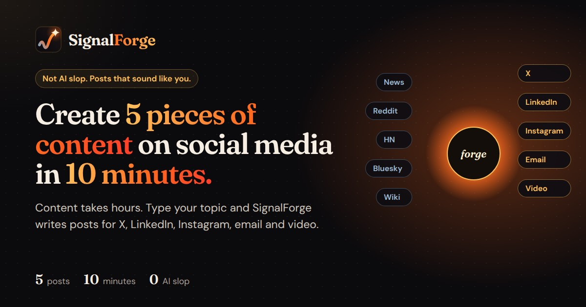

# SignalForge — AI Content Intelligence Studio



**Create 5 pieces of content on social media in 10 minutes.** Posting every day takes hours: finding a topic, checking the facts, then writing it five different ways. SignalForge does that work. Type your topic, tap **Autopilot**, and get an X thread, a LinkedIn post, an Instagram caption, a newsletter and a short video script, built from real stories and real sources. It's not AI slop: every post starts from facts you can trace, follows your angle, and skips the words that give AI away. You read, tweak and approve. SignalForge never posts for you.

**Live app:** https://signalforge-agent.vercel.app

Built with [Agent-Native](https://www.agent-native.com) for the [Builder.io hackathon](https://www.builder.io/hackathon). The live site has a shared AI model key, so new users don't have to connect anything.

## Words you'll see

| Word | Means |
| --- | --- |
| **Signals** | Find trends: the stories people are talking about right now in your topic |
| **Autopilot** | AI does it all: it finds the facts, plans the posts and writes all 5. You approve |
| **Step by step** | You check each article before anything is written |
| **Forge** | Write posts: your workshop, where a story becomes finished posts you can edit |
| **Post plan** | The main point, who it's for, the tone and the key facts every post follows |
| **Calendar** | Plan when to post. Copy each post when it's time, or add them to Google or Apple Calendar |

A 7-step guided tour runs on the first visit and can be replayed from the **?** button.

## The flow

**Autopilot (one tap):** on any trending story, tap **Autopilot · 5 posts**. The agent researches the story, approves the most credible articles, writes the post plan and drafts all five posts in about a minute. Your posts appear first on the Forge, with "How these posts were made" underneath. Autopilot never overrides an article you approved, rejected or added yourself, and posts still need your approval.

**Step by step:**

1. **Signals.** Type your topic (for example "fitness") and pick a country. SignalForge scans six free, keyless feeds: Google News, Hacker News, Reddit, Bluesky, Wikipedia pageviews and Google Trends. It groups what it finds into emerging narratives, each with a momentum score, a stage and the evidence behind it. If a feed is down, the scan still finishes and shows that feed as off. "Improve this list with AI" rewrites the clusters into tighter narratives, citing only real signals.
2. **Forge.** Pick a narrative.
   - **Facts & sources:** "Find articles" pulls source candidates from the free feeds in a few seconds. "Let AI check them" also reads each excerpt and recommends approve or reject, with a reason. A recommendation stays pending until you approve or reject the source yourself, one at a time or in bulk.
   - **Post plan:** locked until at least one source is approved. The server rejects a brief that cites a source you haven't approved. Every field can be edited in place.
   - **Drafts:** written from the brief for X, LinkedIn, Instagram, a newsletter and a short-video script. The server enforces each platform's limits (280 characters per X post, up to 6 posts in a thread) and reports exact counts so the agent can shorten and retry. You can edit inline, use one-tap rewrites (Punchier, Shorter, More personal, More authoritative, Stronger hook) or give your own instruction. Drafts you edited are kept when the agent redrafts. Only you can approve a draft.
3. **Calendar.** Approved posts wait under "Ready to place". You can drag a draft onto a day, or on a phone tap the draft and then the day. You can move posts, mark them published, copy them or take them off the calendar. Two posts on the same platform must be at least 60 minutes apart, and a clash is refused with a clear message. "Add to my calendar" downloads an .ics file with every post, with its full text and a 10-minute reminder, for Google Calendar or Apple Calendar.

SignalForge never posts anywhere for you. "Published" means you posted the content yourself.

## Agent-native by design

Every capability is a single action that the UI, the agent sidebar and MCP clients all call. You can click through the whole flow, or ask the agent something like "forge an X and LinkedIn campaign on the top narrative and put it on Friday" and watch the same screens update.

| Action | What it does |
| --- | --- |
| `discover-signals` | Scan the free feeds for a niche and group signals into narratives |
| `get-signals-board` | Read the signals and narratives |
| `save-narratives`, `update-narrative` | Save sharpened narratives; rename, pick or dismiss one |
| `research-narrative`, `add-source` | Gather source candidates with stored excerpts |
| `review-source` | Approve or reject many sources at once. From the agent it only records a recommendation, except on an Autopilot story. |
| `set-autopilot` | User only: turn Autopilot on or off for a story |
| `get-forge`, `save-brief` | Read the forge; save a brief that may cite approved sources only |
| `save-drafts`, `update-draft` | Write, edit, rewrite or approve platform drafts (limits checked on the server) |
| `get-calendar`, `schedule-draft`, `export-ics` | Schedule, move, unschedule or mark published; export to .ics |

## Human control, enforced on the server

- When the agent reviews a source it only records a recommendation. Only the signed-in user can set a source to approved or rejected, or turn on Autopilot, which lets the agent's picks count for that one story (never over the user's own decisions).
- A brief can only cite approved source IDs.
- Only the user can approve a draft, and a draft over its platform limit can't be approved.
- Only approved drafts can be scheduled. Same-platform clashes are refused.
- All data is stored in SQL per owner, and every query is scoped to the signed-in account.

## Design

SignalForge has its own "heat map" identity: raw signals are cool steel blue, narratives being worked on are ember orange, finished drafts are molten gold, approvals are quench teal and rejections are slag red, all on anvil charcoal.

- **Logo:** a cold signal line that heats as it rises and strikes a spark (`app/components/landing/Logo.tsx`, `public/favicon.svg`).
- **Type:** Fraunces for headlines, DM Sans for text, JetBrains Mono for small data, all self-hosted.
- **Icons:** a custom 24-grid SVG set in `app/components/icons/index.tsx`, also drawn over the framework's chat and settings icons (`scripts/gen-icons.tsx` regenerates `app/components/icons/tabler-swap.css` and `public/icons/sf/`).
- **Landing:** a live canvas hero (`app/components/landing/SignalField.tsx`) where signals from six feeds stream into the forge and leave as five platform drafts. It respects reduced motion.
- **Navigation:** a sidebar on desktop (each item with a plain subtitle: Find trends, Write posts, Plan when to post), a bottom tab bar (Signals, Forge, Calendar, AI help) on phones, and filter tabs on found items, sources, posts and the calendar.
- **Plain words:** coined terms have a dotted underline that explains them on hover or tap (`app/lib/glossary.ts`, `app/components/guide/Term.tsx`); the first-visit tour is `app/components/guide/Tour.tsx`.
- **Agent chat:** its own cooler steel panel, separate from the warm main view, with SignalForge prompts.

## Stack

- Agent-Native (`@agent-native/core`), React Router, React 19, Tailwind
- Anthropic Claude for the agent model (a deployment-wide `ANTHROPIC_API_KEY`; users can also connect Builder.io or their own key in settings)
- Postgres (Neon, through Vercel) using Drizzle migrations
- Deployed on Vercel

## Run it locally

```bash
pnpm install
pnpm dev            # http://localhost:8080
```

Set `ANTHROPIC_API_KEY` (or sign up and connect Builder.io or your own key under **Settings**) to enable the agent. Finding trends, finding articles, editing and the calendar work without it.

Checks:

```bash
pnpm typecheck
pnpm agent-native:doctor
```

## License

[MIT](LICENSE)
